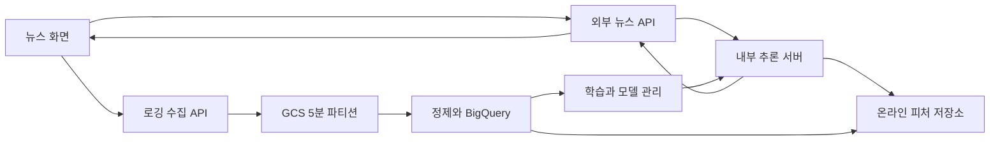

# 세호님의 프론트엔드 실행 계획

회의일 2026-10-31 · 정리일 2026-11-02

## 지금 무엇을 해야 하나

**뉴스를 보여주는 화면에서, 추천 학습에 사용할 수 있는 행동 데이터를 만드는 화면으로 넘어가야 합니다.** 회의록은 김세호의 역할을 프론트엔드·사용자 데이터·행동 수집으로 기록했습니다. 모델 학습 담당자로도 한 번 언급하지만 앞선 역할 분담과 충돌하므로, 모델 개발까지 세호님 업무로 확대하지 않습니다. [E01, Q08](04-evidence.md)

첫 목표는 한 방문자가 뉴스를 보고 클릭한 기록을 서버에서 확인하고, 그 방문자에 대한 추천 결과를 다시 화면에 표시하는 것입니다. 클릭 한 번으로 즉시 재학습되는 시스템을 약속하는 것은 아닙니다. 회의에서는 요청 시 추론과 배치로 갱신되는 피처를 구분했습니다. [E07](04-evidence.md)

## 현재 출발점

아래는 소스 파일과 README를 읽어 확인한 상태입니다. 화면 동작을 이번에 재시험한 결과는 아닙니다.

| 항목 | 현재 상태 | 다음 할 일 |
|---|---|---|
| 피드·상세·카테고리·무한 스크롤 | 가상 기사와 독자를 쓰는 구현이 있음 | 실제 기사·추천 API로 교체 |
| 방문자 저장 | HttpOnly 쿠키, 서버의 독자 ID, 로컬 SQLite 구현이 있음 | 이벤트·좋아요·추천과 같은 독자로 연결 |
| 독자 선택 | 샘플 독자 선택과 실제 방문자가 분리되어 있음 | 실제 이용과 시연 모드를 명확히 구분 |
| 추천 | 샘플 순서를 반환함 | 서버 순위·추천 ID·근거·갱신 시각 표시 |
| 행동 수집 | 노출·클릭·체류 전송 구현이 없음 | 측정과 전송, 서버 수락 확인 구현 |
| 좋아요 | 서버 저장과 UI 구현이 없음 | 언론사 ID와 API 합의 후 구현 |
| 클라우드 연결 | 이 저장소에서 전체 연동을 확인하지 못함 | 로깅 담당자와 첫 이벤트부터 대조 |

`src/service.js`의 다음 페이지 호출은 샘플 피드를 다시 생성하므로 추천 ID가 달라질 수 있습니다. 실제 수집에서는 같은 추천 목록을 넘기는 동안 추천 ID가 유지되어야 합니다. [코드 근거](04-evidence.md)

## 회의에서 프론트엔드에 영향을 준 내용

### 방문자와 행동을 같은 ID로 연결한다

로그인 기능 대신 쿠키 기반 방문자 식별을 사용하고, 좋아요·구독 목록은 백엔드에 저장하는 방향입니다. 현재 쿠키에는 독자 ID 자체가 아닌 임의 토큰이 들어 있습니다. 서버가 이 토큰을 독자 ID로 해석하므로, 프론트에서 쿠키를 직접 읽도록 바꿀 필요가 없습니다. 기존 `/api/v1/visitors/me` 응답을 연결에 활용할 수 있습니다. [E02](04-evidence.md)

브라우저 방문자와 가상 독자의 행동을 섞으면 분석 결과를 믿기 어렵습니다. 실제 방문자는 쿠키로 확인하고, 가상 독자 선택은 시연용으로 구분합니다. 수집을 시작하면 현재 화면의 “클릭·읽기 시간은 수집하지 않습니다” 안내도 실제 동작에 맞춰 바꿔야 합니다.

### 내려받은 기사와 실제로 본 기사를 구분한다

회의에서 말한 ‘인프레션’은 API로 전달한 전체 기사 수이고, ‘노출’은 화면에 실제로 보인 기사입니다. 기존 API 초안은 실제 노출을 `article_impression`이라고 부릅니다. 단어만 맞추지 말고 각각의 의미를 합의해야 합니다. [E03, Q02](04-evidence.md)

권고안은 서버가 전달 목록을 기록하고 프론트는 실제 노출만 측정하는 것입니다. 실제 노출은 카드 50% 이상을 기준으로 합니다. ‘연속 1초’는 기존 초안의 제안이며 이번 회의에서 확정된 값은 아닙니다. 화면 밖에 내려받아 놓은 기사는 실제 노출로 세면 안 됩니다.

노출 후 미클릭은 학습의 부정 사례가 될 수 있습니다. 프론트는 사실을 기록하고, 관찰 기간과 라벨 생성은 데이터·ML 담당자가 정합니다. CTR도 전달 기사 기준인지 실제 노출 기준인지 분모를 명시해야 합니다.

### 전송은 빠르게 하고 서버에서 묶어 저장한다

GCS의 5분 파티션은 서버 저장 단위입니다. 브라우저에서 5분을 기다렸다 전송하면 이탈 시 데이터가 사라지고 수집이 늦어집니다. 회의에서 언급한 1초 또는 1,000건은 서버 큐의 예시이며 브라우저 기준이 아닙니다. 브라우저 전송 간격·최대 개수는 별도로 합의합니다. [E04](04-evidence.md)

전송 실패 때 같은 이벤트 ID로 재시도하고, 서버는 중복을 제거해야 합니다. 서버 수락과 GCS 적재, 분석 반영, 추천 반영은 각각 다른 상태입니다.

### 체류 10초와 좋아요 대상은 구현 전에 정한다

회의록은 체류를 ‘10초 제한, 너무 긴 체류 제외’라고 적었습니다. 기존 초안은 ‘10초마다 활성 체류 증가분 전송’입니다. 둘은 다릅니다. **총 체류를 10초로 자를지, 긴 체류를 제외할지, 10초마다 보고할지 확인해야 합니다.** 미결정 상태에서도 탭 숨김 시간 제외와 밀리초 단위 규칙은 초안으로 준비할 수 있습니다. [Q01](04-evidence.md)

좋아요는 결정란에 ‘언론사 좋아요’로 기록되어 있습니다. 따라서 언론사 좋아요를 우선 대상으로 삼되, 기사 좋아요·구독과 같은 기능인지 팀에 확인합니다. 버튼 위치, 취소, 새로고침 후 복원, 실패 시 원상복구까지 한 작업으로 묶습니다. [E05, Q03](04-evidence.md)

## 구현 순서와 완료 기준

아래 순서는 제안입니다. 회의에서 일정이나 마감일을 정한 기록은 없습니다.

| 순서 | 작업 | 눈으로 확인할 완료 결과 | 협업 상대 |
|---|---|---|---|
| 1 · FE-01 | 이벤트 정의와 API 계약 정리 | 익명 독자·노출·체류·좋아요·추천 응답 예시를 팀이 같은 뜻으로 읽음 | 백엔드·데이터·ML |
| 2 · FE-02 | 방문자와 피드 연결 | 재방문 시 같은 독자로 조회하고 시연 독자와 섞이지 않음 | 백엔드 |
| 3 · FE-03 | 노출·클릭·전송 연결 | 화면 밖 카드에는 노출이 없고 클릭 재전송도 서버에 한 번만 남음 | 로깅·인프라 |
| 4 · FE-04 | 체류 수집 | 합의한 10초 규칙대로 저장되고 숨긴 탭 시간은 제외됨 | 데이터 |
| 5 · FE-05 | 언론사 좋아요 | 저장·취소·재방문 복원과 실패 처리가 동작함 | 뉴스 백엔드 |
| 6 · FE-06 | 기사·추천 API 연결 | 서버 순서가 유지되고 신규 독자·오류·빈 결과가 구별됨 | 기사·ML·백엔드 |
| 7 · FE-07 | 전체 연결 시연 | 한 이벤트를 로깅·적재·추천 응답까지 ID로 추적함 | 전체 팀 |

FE-01 이후 FE-02와 API 응답 어댑터 준비는 진행할 수 있습니다. FE-03은 안정적인 추천 ID를 담은 계약용 응답으로 먼저 검증하고, FE-06에서 실제 추천 서버로 바꿉니다. 좋아요는 해당 계약만 정해지면 체류와 별개로 진행할 수 있습니다.

## 팀의 일과 세호님의 일을 구분한다

| 담당 영역 | 책임 | 세호님이 주고받을 것 |
|---|---|---|
| 프론트엔드 · 김세호 | 독서 화면, 사용자 식별 연결, 행동 측정·전송, 좋아요 UI, 수용 검증 | 이벤트 예시, 화면에 필요한 API 필드, 실패 처리 |
| 인프라 · 장주현 | 배포, 로깅 수신과 저장 경로 협의, 권한과 비밀 관리 | 수집 주소, 쿠키·Origin 정책, 수락 응답, 로그 조회 방법 |
| 기사 데이터 · tae won Kim으로 기록 | 기사 ID·이미지·언론사 포함 데이터 준비 | 안정적인 article_id·publisher_id, 본문 형식, 출처 |
| 데이터·ML · mo shin과 tae won Kim으로 기록 | 정제, 피처, 라벨, 학습·서빙 | 이벤트 의미, 추천 응답, 신규 독자 대체 전략 |
| 뉴스 API·좋아요 API 담당 | 담당자 추가 확정 필요 | 방문자 검증, 기사·추천·좋아요 계약 |
| 온라인 지표 대시보드 담당 | 팀 과제로 기록, 담당자 미정 | 노출·클릭·체류 정의와 추적 가능한 데이터 |

전체 흐름은 다음과 같습니다. 프론트가 내부 추론 서버나 저장소를 직접 호출하지 않습니다.

그림은 회의 내용을 요약한 목표 구조입니다. 로깅 API를 별도 주소로 둘지 뉴스 API를 통해 받을지는 미결정입니다. 정제 주기, 모델 전달 방식, 배포 제품도 최종 확인이 필요합니다.

## 다음 팀 미팅에 가져갈 질문

1. 10초는 체류 상한, 제외 기준, 보고 주기 중 무엇인가요? 실제 23초 읽은 사례가 어떻게 저장되어야 하나요?
2. 전달 목록과 실제 노출을 어떤 이벤트 이름으로 저장하나요? 노출 50%에 연속 1초 조건도 붙이나요?
3. 좋아요 대상은 언론사인가요? 구독과 같은 기능인가요? publisher_id와 저장·조회·취소 API를 누가 제공하나요?
4. 브라우저는 어느 API로 얼마나 자주 보내나요? 서버 응답의 ‘수락’은 어디까지 저장됐다는 뜻인가요?
5. 실제 방문자와 가상 독자의 추천·로그를 어떻게 구분하나요? 저장하지 않은 방문자는 기본 피드만 보나요?
6. 뉴스 API 담당자와 배포 환경은 무엇인가요? 회의록의 클라우드타입과 Cloud Run 중 어느 쪽인가요?
7. 본문은 JSON의 텍스트인가요, 서버 HTML인가요? 신규 독자와 모델 장애 때 어떤 피드를 주나요?
8. 온라인 지표 대시보드는 누가 맡나요? 브라우저 정보의 수집 필드와 보관 기간은 무엇인가요?

처음부터 새 프레임워크로 옮기거나 로그인·검색·댓글을 추가할 근거는 없습니다. 현재 구조를 활용해 첫 연결을 완성하고, 측정된 문제에 맞춰 다음 작업을 정하는 것을 권합니다.
